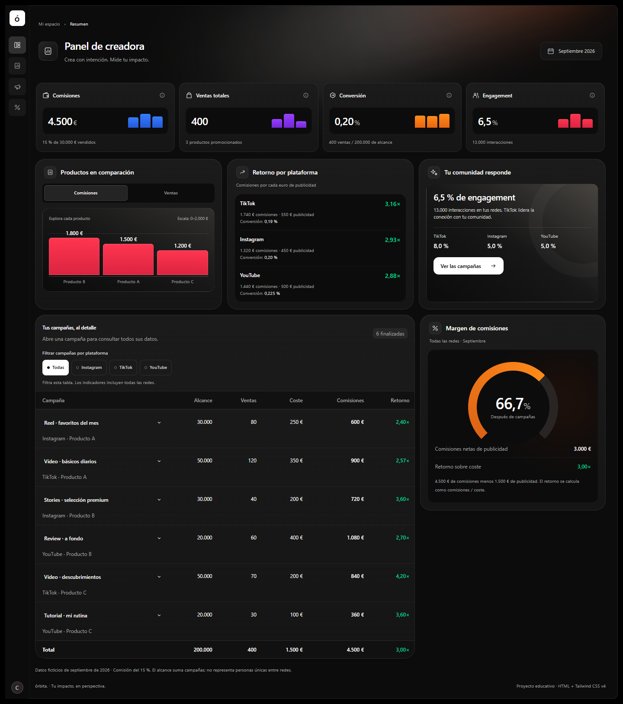
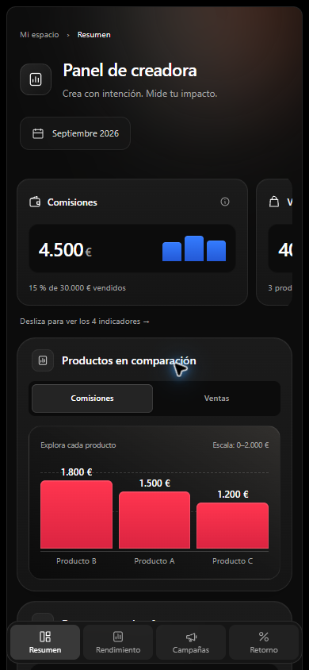

# Contexto del proyecto Órbita

> Documento de continuidad y buenas prácticas. Actualizado el 14 de octubre de 2026.

## 1. Objetivo y alcance

Órbita es un dashboard educativo para una creadora que promociona productos en Instagram, TikTok y YouTube. Consolida comisiones, ventas, conversión, engagement y rendimiento de campañas.

Se desarrolló para el proyecto **«Un dashboard sencillo en Tailwind CSS» de 4Geeks Academy**. Su objetivo evaluable es demostrar estructura semántica, uso de Tailwind, jerarquía visual y adaptación a distintos tamaños de pantalla. No es una aplicación conectada a datos reales.

### Referencias del proyecto

- Repositorio de entrega: https://github.com/rogerdevmtz/orbita-dashboard-tailwind
- Rama principal del trabajo: `codex/dashboard-tailwind`.
- Archivo ejecutable: `index.html`.
- Código auditado: commit `4876915f57fd41b23d4f8a6ab69a327f5af18cee`.
- Plantilla de origen: https://github.com/4GeeksAcademy/html-hello
- Enunciado consultado: https://learn.4geeks.com/es/main-cohort/spain-aie-pt-5/syllabus/web-ui-fundamentals-with-tailwind/project/simple-dashboard-tailwind-css?moduleId=2

## 2. Requisitos que debemos conservar

| Requisito | Implementación |
| --- | --- |
| Al menos tres KPIs | Cuatro: comisiones, ventas, conversión y engagement |
| Al menos tres drivers | Comparación de productos, retorno por plataforma y comunidad/engagement |
| Detalle operativo | Tabla de seis campañas con filtros, totales y detalles desplegables |
| Tres bloques claros | Indicadores arriba, drivers en el centro y operación debajo |
| HTML semántico | Landmarks, títulos, fieldsets, listas de definiciones y tabla semántica |
| Tailwind CSS v4 | CDN indicado por 4Geeks y clases utility |
| Mobile-first | Adaptaciones con `sm`, `md`, `lg` y `xl` |
| Consistencia visual | Patrones compartidos de tarjetas, controles, bordes, tipografía y espaciado |
| Repositorio propio | Código publicado en el repositorio de entrega |

El enunciado menciona CSS y media queries en la entrega, pero también exige usar Tailwind y evitar CSS personalizado. En esta implementación Tailwind genera los estilos y los breakpoints a partir de las clases del HTML; no se entrega una hoja CSS manual.

## 3. Tecnología y organización

### Stack real

- HTML5 en español, con codificación UTF-8.
- Tailwind CSS v4 mediante el CDN requerido:

```html
<script src="https://cdn.jsdelivr.net/npm/@tailwindcss/browser@4"></script>
```

- SVG inline para los iconos.
- Controles y comportamiento nativos de HTML.
- Variantes de Tailwind apoyadas en `:checked`, `:has()`, `:target` y estados de foco.

### Qué no necesita el proyecto

No utiliza React, Vue, backend, base de datos, JavaScript de aplicación, dependencias de gráficos ni CSS escrito a mano. Tampoco necesita instalación de paquetes, compilación o `package.json` para abrirlo.

Python se utiliza únicamente como servidor estático durante el desarrollo. `html-validate` y axe-core se utilizaron para revisar el proyecto; no forman parte del dashboard entregado.

### Organización del archivo

| Zona | Identificador o elemento | Responsabilidad |
| --- | --- | --- |
| Metadatos | `head` | Idioma, título, descripción, Open Graph y carga de Tailwind |
| Navegación | `aside` y `nav` | Acceso por anclas a las secciones |
| Contenido | `main#contenido` | Región principal y destino del salto de teclado |
| Cabecera | `header` | Título, contexto y período |
| Indicadores | `#resumen` | Cuatro KPIs con ayudas y minibarras por plataforma |
| Drivers | `#rendimiento` | Productos, retorno y comunidad |
| Campañas | `#campanas` | Filtros, tabla, detalles y totales |
| Margen | `#retorno` | Resultado después de publicidad |
| Ayudas | Región «Ayudas de los indicadores y productos» | Popovers contextuales |
| Cierre | Nota de datos y `footer` | Alcance de la muestra y contexto educativo |

## 4. Datos y fórmulas

Todos los datos son ficticios y corresponden a septiembre de 2026. La comisión es del 15 % del importe vendido.

| Producto | Precio | Unidades | Comisión por unidad | Comisiones totales |
| --- | ---: | ---: | ---: | ---: |
| A | 50 € | 200 | 7,50 € | 1.500 € |
| B | 120 € | 100 | 18 € | 1.800 € |
| C | 80 € | 100 | 12 € | 1.200 € |
| Total | | 400 | | 4.500 € |

| Plataforma | Campañas | Alcance | Ventas | Publicidad | Comisiones | Retorno |
| --- | ---: | ---: | ---: | ---: | ---: | ---: |
| Instagram | 2 | 60.000 | 120 | 450 € | 1.320 € | 2,93× |
| TikTok | 2 | 100.000 | 190 | 550 € | 1.740 € | 3,16× |
| YouTube | 2 | 40.000 | 90 | 500 € | 1.440 € | 2,88× |
| Total | 6 | 200.000 | 400 | 1.500 € | 4.500 € | 3,00× |

- Ventas brutas: suma de precio × unidades = **30.000 €**.
- Comisiones: ventas brutas × 15 % = **4.500 €**.
- Conversión: ventas / alcance × 100 = **0,20 %**.
- Engagement: 13.000 interacciones / 200.000 de alcance × 100 = **6,5 %**.
- Retorno sobre publicidad: comisiones / coste = **3,00×**. No equivale al ROI neto.
- Comisiones después de publicidad: 4.500 − 1.500 = **3.000 €**.
- Margen después de publicidad: 3.000 / 4.500 × 100 = **66,7 %**.

El alcance suma campañas; no representa personas únicas entre redes. Las tasas por plataforma deben calcularse con sus propios denominadores; no se deben promediar porcentajes sin ponderación.

## 5. Diseño aprobado

La referencia es un dashboard oscuro de planificación de presupuesto. Se conserva su lenguaje de fondo negro, superficies carbón, tarjetas redondeadas, iluminación cálida, navegación compacta y gráficos de color.

### Decisiones que deben mantenerse

- Colores intensos sobre superficies oscuras; evitar volver a tonos pálidos o reflejos metálicos blanquecinos.
- Profundidad discreta mediante degradados de superficie, bordes finos y sombras suaves.
- Cabecera con aire, título claro y fecha en una superficie oscura.
- Iconos de trazo coherente y títulos de panel alineados.
- Tarjeta «Tu comunidad responde» con fondo de profundidad, aro decorativo, tasas por red y acceso a campañas.
- Información directa, sin añadir acciones o desgloses redundantes.
- Sin botón «Datos de ejemplo»; el carácter ficticio se explica en el cierre.

### Paleta de las estadísticas

| Uso | Inicio del degradado | Final del degradado |
| --- | --- | --- |
| Comisiones | `#347cff` | `#2459d6` |
| Ventas | `#963fff` | `#7428d6` |
| Conversión | `#ff8b19` | `#e96510` |
| Engagement y productos | `#ff354f` | `#db2441` |
| Indicador circular | `#dc6115` | `#ff8b19` |

El color acompaña a nombres, valores y unidades. No debe ser la única forma de transmitir información.

## 6. Comportamiento y experiencia de usuario

### Navegación y desplazamiento

En escritorio, la barra lateral mide 56 px y queda fija fuera del marco del dashboard. Solo se desplaza el contenido de `main`. Esto evita que la navegación se mueva o se recorte junto con el contenido.

En móvil, la navegación es un menú inferior fijo. El contenido reserva espacio y tiene márgenes de desplazamiento para reducir el riesgo de que el menú tape un elemento enfocado.

### Indicadores en móvil

Los cuatro KPIs forman un grupo horizontal deslizable con ajuste por tarjeta. Una parte de la siguiente tarjeta y una pista textual indican que hay más contenido. El grupo recibe foco y permite navegación con teclado.

El desplazamiento horizontal es local al grupo, solicitado por el usuario. La página completa no debe desbordarse. Desde `sm` se muestran dos columnas y desde `lg`, cuatro.

### Gráficos y ayudas

- Las minibarras representan datos por plataforma, en el orden Instagram, TikTok y YouTube.
- Cada minibarra tiene nombre accesible y ayuda con plataforma, valor y contexto.
- El gráfico de productos cambia entre comisiones y unidades mediante radios nativas.
- Cambian tanto los valores como las alturas y la escala; no es una imagen decorativa.
- Las ayudas con estilo se abren mediante clic, toque o Enter, y se cierran con Escape o al pulsar fuera.
- El texto breve al pasar el cursor lo gestiona el navegador mediante `title`. Se retiraron las vistas previas personalizadas duplicadas para evitar problemas de cierre y accesibilidad.

### Tabla de campañas

Los filtros afectan solo a las filas, el contador y los totales de la tabla. Los KPIs y drivers siguen representando todas las redes; la interfaz lo indica.

En pantallas estrechas se priorizan columnas. Los datos secundarios siguen disponibles en los detalles nativos de cada campaña.

### Movimiento

El feedback de pulsación es breve: escala 0,97 durante 150 ms, con transición de transform. Se respeta `prefers-reduced-motion` y se evita animar la respuesta de teclado. Los valores y las alturas de los gráficos cambian de inmediato.

## 7. Accesibilidad aplicada y alcance de la auditoría

### Mejoras incorporadas

- Idioma del documento y jerarquía de títulos.
- Un `main` identificado por el título principal.
- Enlace «Saltar al contenido».
- Navegación y ayudas agrupadas en regiones con nombres.
- Foco visible y margen junto al menú inferior.
- Botones y enlaces nativos con nombres accesibles.
- Radios con etiquetas, fieldsets y legends.
- Tabla con caption, encabezados de columna y encabezados de totales.
- Descripciones de plataforma y producto asociadas a los desplegables de campañas.
- Mayor contraste de textos secundarios y corrección del estilo de selección de texto.
- Ayudas operables con teclado y cierre con Escape.
- Movimiento reducido y áreas de interacción comprobadas en las minibarras.

### Verificaciones realizadas

Se ejecutó `html-validate` sin errores y axe-core de forma temporal en el navegador. Las comprobaciones finales no detectaron infracciones en las reglas ejecutadas, incluyendo una ayuda abierta. El auditor temporal se retiró al recargar y no se incorporó al HTML.

También se comprobaron teclado, salto al contenido, apertura y cierre de ayudas, desplegables, movimiento reducido, referencias ARIA, identificadores y anclas internas. Se revisó el contraste de textos relevantes, teniendo en cuenta que los fondos con degradados requieren revisión manual.

Esto no constituye una certificación WCAG completa. No se hicieron pruebas con lector de pantalla, dispositivos físicos ni todos los motores de navegador.

## 8. SEO técnico y GEO

### Implementado

- Título y descripción específicos, coherentes con el contenido.
- `lang="es"`, UTF-8 y viewport sin bloquear el zoom.
- Metadatos Open Graph: título, descripción, tipo, idioma y nombre del sitio.
- Contenido principal en HTML, sin depender de una aplicación JavaScript para generar los datos.
- Títulos, tablas, listas y nombres de sección que facilitan interpretar la información.
- Contexto explícito de datos ficticios, período y comisión.
- Fórmulas y distinción entre retorno sobre publicidad y margen.
- Preconexión al CDN usado por Tailwind.

Para GEO se priorizó contenido claro y verificable dentro del alcance educativo. No se añadieron datos estructurados ficticios, FAQs artificiales, archivos para buscadores ni afirmaciones de negocio reales.

### Pendiente si se publica como sitio web

El enlace actual es un repositorio de código, no una web desplegada. Una publicación posterior permitiría definir la URL canónica, comprobar indexación, configuración del servidor y rendimiento real. No se inventó una URL canónica ni se prometió posicionamiento o inclusión en respuestas de IA.

La entrega educativa conserva el CDN de Tailwind porque lo requiere el enunciado. No se debe migrar a un build de producción sin revisar antes el alcance y los requisitos de la entrega.

### Fuentes consultadas

- SEO: https://developers.google.com/search/docs/fundamentals/seo-starter-guide
- Funciones de IA y búsqueda: https://developers.google.com/search/docs/appearance/ai-features
- Tamaño mínimo de objetivos: https://www.w3.org/WAI/WCAG22/Understanding/target-size-minimum.html
- Revisión de interfaz: https://github.com/vercel-labs/web-interface-guidelines/blob/main/command.md

## 9. Cómo ejecutar el proyecto

### Local

Desde la carpeta que contiene `index.html`:

```bash
python -m http.server 5500 --bind 127.0.0.1
```

Abrir http://127.0.0.1:5500. En entornos donde el ejecutable se llame `python3`, usar ese nombre. También se puede abrir el HTML directamente; se necesita conexión para cargar Tailwind.

### GitHub Codespaces

En la terminal, desde la carpeta del proyecto:

```bash
python3 -m http.server 5500
```

Abrir **Ports / Puertos**, localizar el puerto **5500** y pulsar **Open in Browser / Abrir en navegador**. Si no aparece, añadirlo con **Add Port**. Mantener la terminal activa y recargar el navegador después de guardar cambios. Para detener el servidor, usar Ctrl+C.

No se necesita crear un servidor Python dentro del repositorio ni instalar dependencias del dashboard.

## 10. Validación antes de futuros cambios

1. Leer el enunciado y este contexto antes de modificar el stack o la estructura.
2. Conservar los cuatro KPIs, tres drivers y la tabla operativa.
3. Mantener precios, comisión y coherencia de todos los cálculos.
4. Revisar los estados Comisiones/Ventas, todos los filtros y los detalles de campaña.
5. Comprobar móvil estrecho, tablet y escritorio. Se han revisado tamaños de 320 a 1440 px durante el desarrollo.
6. Confirmar que la página no desborda horizontalmente y que la navegación permanece fija.
7. Probar teclado, Escape, foco, ayudas y movimiento reducido.
8. Validar el HTML y revisar el diff:

```bash
npx --yes html-validate index.html
git diff --check
```

9. Confirmar que el repositorio contiene el dashboard, este contexto y las dos capturas de presentación:

```bash
git ls-files
```

10. Hacer commit y push; comprobar que el enlace abre la rama correcta.

No añadir pruebas que solo reproduzcan la implementación. Ajustar las comprobaciones al riesgo real del cambio y repetir las relevantes cuando se modifique el comportamiento o el diseño.

## 11. Presentación y entrega

El repositorio reúne el dashboard ejecutable, su documentación de contexto y dos capturas de la versión final.

```text
index.html
CONTEXTO.md
capturas/
  escritorio.png
  mobile.png
```

### Vista de escritorio

Captura del dashboard completo a 1440 × 1626 px: navegación lateral fija, cuatro indicadores, tres drivers, campañas y margen de comisiones.



### Vista móvil

Captura de la vista inicial a 390 × 844 px: cabecera, grupo deslizable de indicadores, gráfico de productos y navegación inferior fija. Los demás indicadores se consultan deslizando el grupo; las campañas y el resto de los paneles aparecen al desplazarse hacia abajo.



### Acceso al proyecto

[Ver el repositorio de entrega](https://github.com/rogerdevmtz/orbita-dashboard-tailwind).

Para ejecutar el dashboard, seguir los pasos de la sección 9. Las capturas documentan la apariencia; el comportamiento se comprueba abriendo `index.html`.
